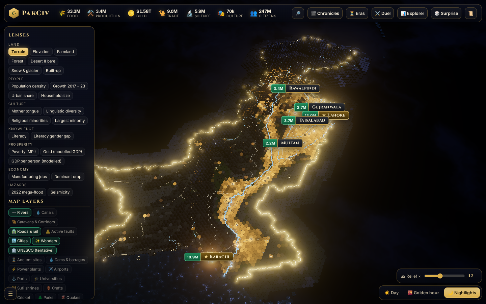

# PakCiv — Pakistan as a 3D strategy map, built from real data

PakCiv draws the **real** Pakistan as a Civilization-style hex board in **Three.js/WebGL**: 3,409 extruded hexes rising
from the Arabian Sea to the 8,611 m summit of K2, with animated rivers, glowing trade corridors, cities, wonders, lenses,
a 2022 flood-surge replay, an Era Time-Machine, guided story tours and a District Duel. It is inspired by Andrej Karpathy's
[usaciv](https://karpathy.ai/usaciv/). **Every number traces to a public source listed in the in-app Almanac (📜).**
Modelled values (Gold = gridded GDP) are labelled as models; missing data stays "—", never 0.



## Run it

```bash
npm install
npm run dev        # http://127.0.0.1:5173
npm run build      # static bundle in dist/ — deploy anywhere (GitHub Pages, Cloudflare Pages, S3…)
npm run preview    # serve dist/ locally
```

It is a 100% static site: no backend, no API keys. The processed data (~2 MB JSON) ships in `web/public/data/`.

## What's in it

- **The board** — 20 km hexes (Albers equal-area), Copernicus DEM heights with a 1–30× relief slider, ESA WorldCover
  terrain with procedural crop rows, dunes, forest canopy, glaciers and street grids; low-poly peaks with a real snowline;
  a shimmering sea masked to the coastline; neighbouring countries sink into a cloud "fog of war".
- **Lighting moods** — Day, Golden hour and **Nightlights** (every hex glows with its census-scaled population density).
- **Water** — OSM rivers with flowing currents (toggle the **Indus Waters Treaty** view: western rivers → Pakistan,
  eastern → India), 167 canals, 28 dams & barrages with WAPDA/Wikidata facts.
- **Caravans & Corridors** — GT Road, Karakoram Highway, CPEC eastern & western alignments, Makran Coastal Highway,
  Indus Highway and the ML-1 railway, with travelling pulses of light. No fake freight volumes.
- **Cities** — 47 cities with Census 2023 urban populations, instanced skylines with lit windows at night, Civ banners.
  **City View**: metro yields, specialised "city districts" (Economic Census location quotients), citizens at work,
  nearby wonders/resources and peer cities.
- **Wonders** — 3D silhouettes (mosques, minars, stupas, forts, tombs, dams, port cranes, summit beacons) for the
  eight-thousanders, UNESCO sites and curated landmarks; plus universities, Sufi shrines, crafts, cricket grounds, parks.
- **Yields** — Food (cropped area, Agricultural Census 2024), Production / Trade / Science / Culture (Economic Census
  2023 workforce by PSIC section) and Gold (modelled GDP, Kummu et al.).
- **25 lenses** — elevation, land cover, density, growth, urban share, household size, mother tongue, linguistic
  diversity, religious minorities, literacy & gender gap, MPI poverty, modelled GDP, manufacturing LQ, dominant crop,
  2022 flood, seismicity. Legends are histograms you can brush to highlight hexes.
- **2022 mega-flood** — UNOSAT's VIIRS footprint plus a week-by-week surge playback driven by UNOSAT's district flood
  evolution table (Aug → Dec 2022), with NDMA and PDNA headline facts.
- **Era Time-Machine** — Mehrgarh → Indus Valley → Gandhara → Arab Sindh → Sultanate → Mughal → Raj canal colonies →
  modern Pakistan: 42 dated sites light up with beams while lighting and layers change.
- **Chronicles of Pakistan** — seven cinematic tours with captions computed from the data.
- **District Duel**, **Explorer** (table + scatter + brushing across all 160 districts), **Surprise me** (fly to an outlier),
  fuzzy **search** (`/`), shareable URL state, keyboard shortcuts (`T` tours, `Y` eras, `D` duel, `E` explorer, `S` surprise,
  `L` lighting, `[ ]` relief, `H` home, `?` Almanac).

## Data pipeline

```
pipeline/
  common.py          cached downloads with provenance (url, bytes, sha256, date), projection, hex grid
  sources/*.py       one module per publisher → data/interim/<id>.json (each has an INFO dict for the Almanac)
  build/world.py     terrain, land/sea, districts, flood footprint → web/public/data/world.json
  build/atlas.py     districts + yields + lenses + hex values → atlas.json, cells.json
  build/layers.py    rivers, corridors, roads, sites → layers.json
  build/catalog.py   every source + file provenance → sources.json (the Almanac)
```

```bash
python3 -m venv .venv && .venv/bin/pip install rasterio shapely pyproj pdfplumber openpyxl numpy pyshp osmium
for m in cod_ab dem landcover census2023 econ_census mpi crops gdp_grid unosat_flood hazards power_plants airports \
         ports transport water_infra cities unesco wonders universities culture eras; do .venv/bin/python -m pipeline.sources.$m; done
for b in world atlas layers districts_web catalog manifest; do .venv/bin/python -m pipeline.build.$b; done
```

Raw downloads go to `data/raw/` (git-ignored). Large rasters (Copernicus DEM, ESA WorldCover, Kummu GDP) are read in place
from cloud-optimised GeoTIFFs with HTTP range requests.

## Honest caveats

- District frame: OCHA COD-AB 2022 (160 districts); post-2022 splits are folded into parents. Boundaries follow UN/OCHA
  convention and do not imply endorsement of any claim.
- AJK and Gilgit-Baltistan are not covered by PBS Census 2023 / Economic Census tables: their population is WorldPop 2025
  and most district statistics show "—".
- Gold is a **model** (gridded GDP, PPP). Economic Census workforce counts establishments only (no farms, households).
- Agricultural Census crop areas exceed the usual official crop estimates; use them for crop mix, not totals.
- Corridors are drawn from OSM highway geometry; they do not represent freight volumes.

Data © their publishers (see the Almanac). Code: MIT.
