# living pakistan

**Pakistan as a 3D Civilization-style strategy map, built entirely from real public data.**

Every hex is a real 20 km patch of the country, raised to its real height between the Arabian Sea and K2 (8,611 m), and
coloured by what is actually there. Every number on screen comes from a public source, and you can trace it back in the
in-app Almanac.

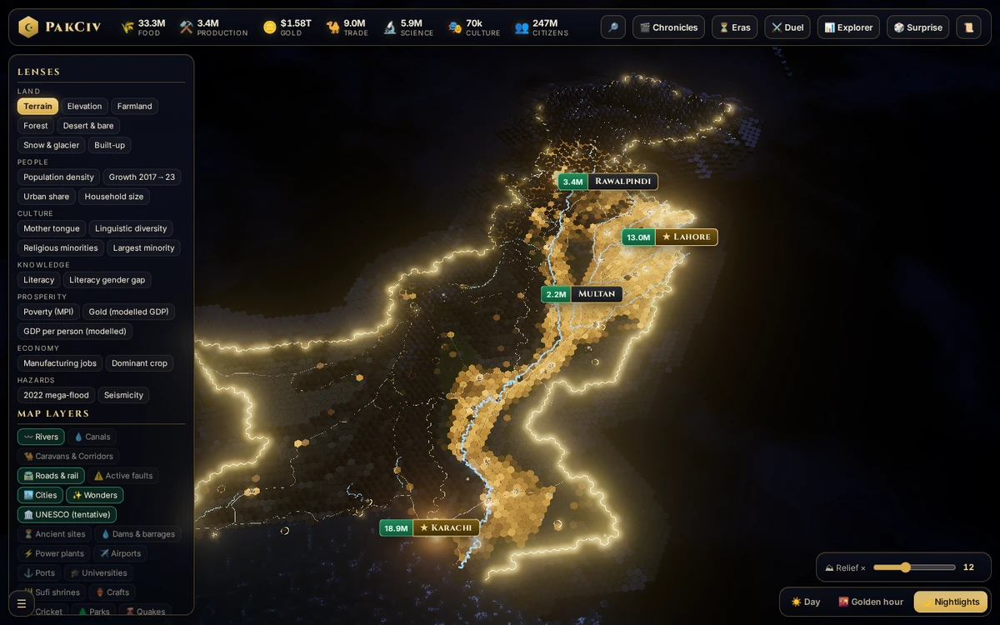

**🎬 96-second product demo** — rendered locally to `previews/livingpakistan-demo.mp4` by `npm run video:record && npm run video:compose`
(kept out of git so the repo stays lean; see [scripts/video/](scripts/video/)).

| | | | | |
|:-:|:-:|:-:|:-:|:-:|
| **3,409** hexes | **160** districts | **24** lenses | **47** cities · **46** wonders | **23** public sources |

---

## Contents

- [Why living pakistan](#why-livingpakistan)
- [Feature tour](#feature-tour)
- [Yields: the game words and what they really measure](#yields-the-game-words-and-what-they-really-measure)
- [Architecture](#architecture)
- [Data sources (all 23)](#data-sources-all-23)
- [Honest caveats](#honest-caveats)
- [Run it locally](#run-it-locally)
- [Rebuild the data](#rebuild-the-data)
- [Repository layout](#repository-layout)
- [Credits & licence](#credits--licence)

---

## Why living pakistan

Andrej Karpathy's [usaciv](https://karpathy.ai/usaciv/) showed that a country's statistics are much more fun to explore
when they look like a Civilization board: hexes, yields, cities, wonders and lenses. living pakistan asks what that would look
like for Pakistan, and tries to make the result **unmistakably Pakistani** rather than a reskinned US map:

- **The vertical drama.** The board climbs from the Indus Delta mangroves to five of the world's fourteen
  eight-thousanders, with a relief slider that runs from a flat board (×1) to a deliberately exaggerated Karakoram (×30).
- **The Indus.** Rivers flow with animated currents, a toggle colours them by the 1960 Indus Waters Treaty, and the
  canal colonies, barrages and dams that feed the irrigated plains are all on the map.
- **People and languages.** Census 2023 mother tongues, religious minorities, literacy and the literacy gender gap,
  shown district by district.
- **Climate stakes.** The 2022 mega-flood plays back week by week from UNOSAT satellite extents.
- **Deep history.** An Era Time-Machine lights up 42 dated sites across 9,000 years, from Mehrgarh to modern Pakistan.

**It is honest about its data.** Pakistan does not publish official district GDP, so the "Gold" yield is a **gridded GDP
model** and is labelled as one everywhere. Missing data shows as "—", never as 0. The census join reproduces the official
national total of **241,499,431** people exactly. A data-feasibility audit written before any code is in
[docs/livingpakistan-data-sources.md](docs/livingpakistan-data-sources.md).

---

## Feature tour

### The board: relief, terrain and lighting

The country is cut into 3,409 extruded hexes (20 km corner to corner, on an Albers equal-area projection), drawn as one
`InstancedMesh`. Heights come from Copernicus DEM. Terrain comes from ESA WorldCover and is drawn with procedural shaders
for crop rows, dunes, forest canopy, glaciers and street grids. Peaks are low-poly instanced cones with a snowline set in
world height. A shimmering sea shader is masked to the real coastline, and neighbouring countries sink away into a cloudy
"fog of war". The national frontier glows gold.

There are three lighting moods. **Day** and **Golden hour** are self-explanatory. In **Nightlights**, every hex glows by
its census-scaled population density and city skylines light their windows.

| Day | Golden hour over the Karakoram |
|:-:|:-:|
| 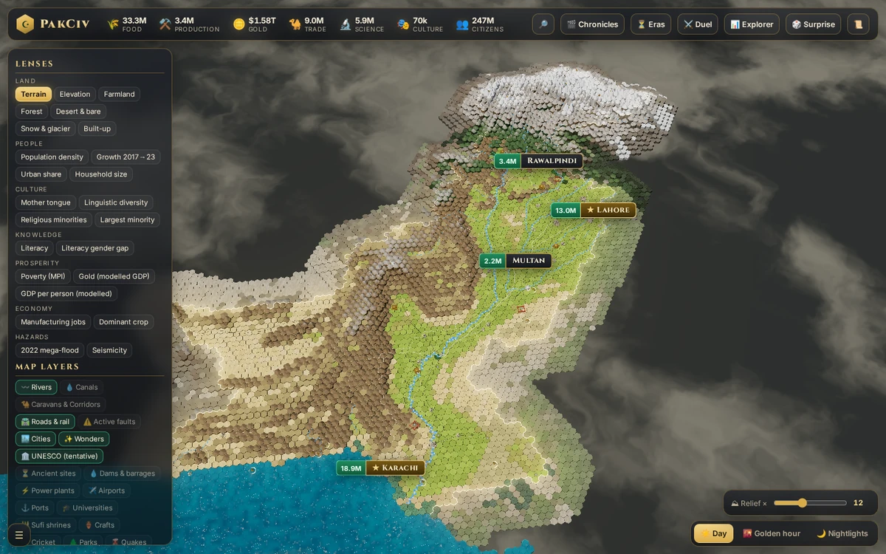 | 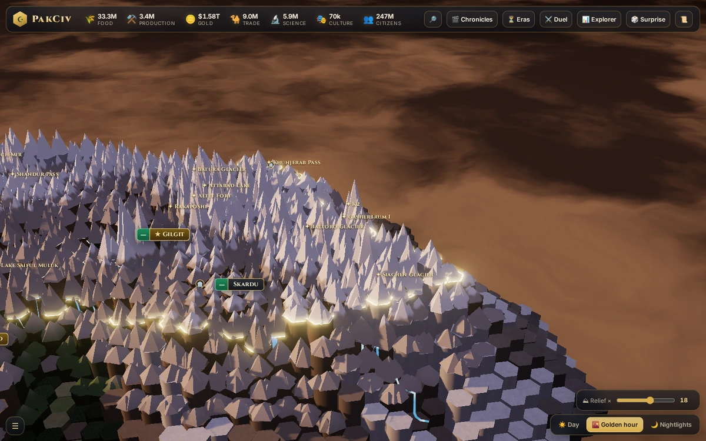 |

### 24 lenses

Lenses recolour the board. There are 24 of them in seven groups, some at hex level and some at district level:

| Group | Lenses |
|---|---|
| Land | Terrain · Elevation · Farmland · Forest · Desert & bare · Snow & glacier · Built-up |
| People | Population density · Growth 2017→23 · Urban share · Household size |
| Culture | Mother tongue · Linguistic diversity · Religious minorities · Largest minority |
| Knowledge | Literacy · Literacy gender gap |
| Prosperity | Poverty (MPI) · Gold (modelled GDP) · GDP per person (modelled) |
| Economy | Manufacturing jobs · Dominant crop |
| Hazards | 2022 mega-flood · Seismicity |

Each legend is a histogram. Hover over a bar and the matching hexes light up on the map. Every legend names its source.

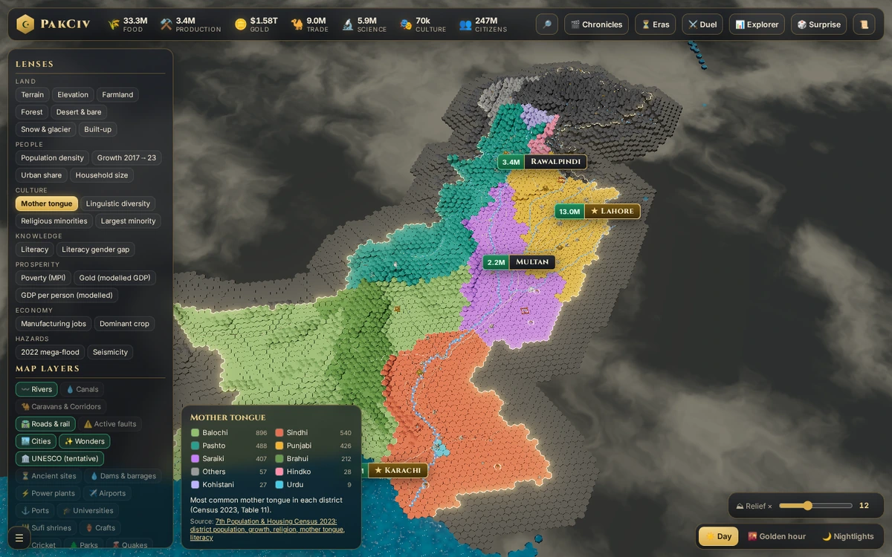

### Cities & City View

The 47 cities are shown as instanced 3D skylines with Civ-style banners, sized by Census 2023 urban-locality population.
Click a banner to open its **City View**, which shows:
- metro yields
- specialised **city districts** (Healing quarter, Harbor & logistics, Industrial zone, Campus and others), assigned by
  Economic Census location quotients
- a "citizens at work" strip
- nearby wonders and resources, and peer cities of similar size

If you click any other hex instead, you get its **micro-civilisation card**: elevation, land cover, people, modelled GDP,
2022 flood impact, earthquakes since 1902, and the nearest city and wonder. Shift-click opens the whole district.

| City View: Karachi | Any hex's micro-civilisation card |
|:-:|:-:|
| 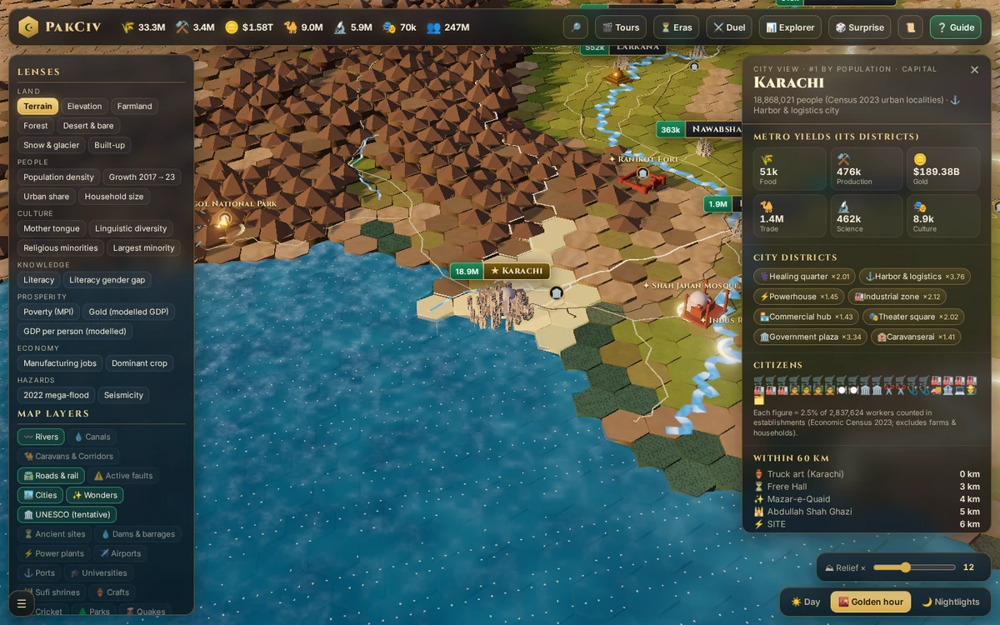 | 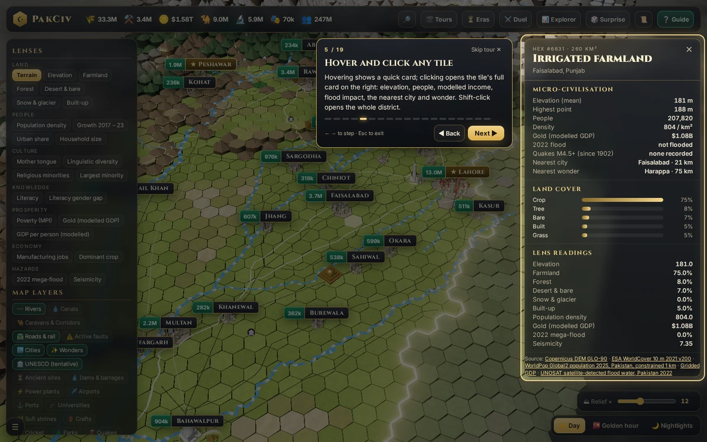 |

### Wonders

There are 46 wonders, each drawn as a small 3D silhouette: a mosque, minar, stupa, fort, tomb, dam, port crane or summit
beacon. They cover the eight-thousanders, UNESCO World Heritage sites and curated landmarks such as Badshahi Mosque,
Mohenjo-daro, Taxila, Rohtas Fort, Faisal Mosque, Deosai and the Karakoram Highway. Every wonder card links to its
reference. You can also switch on more than 380 pins for:
- UNESCO tentative sites, ancient sites, dams and barrages, power plants, airports, ports and universities
- Sufi shrines, crafts and cricket grounds
- national parks, notable quakes, heat records and GLOF sites

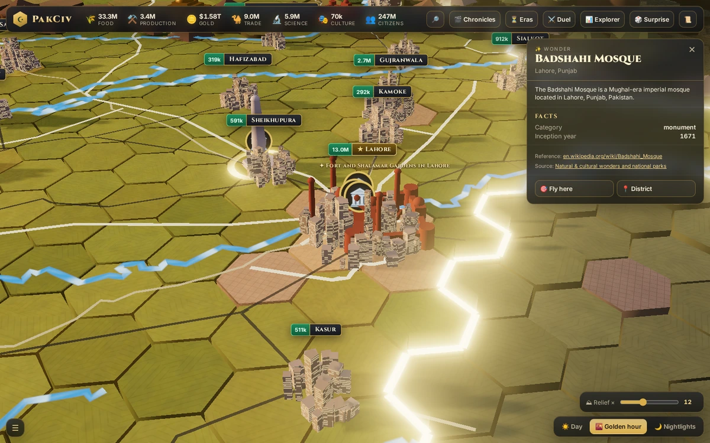

### Rivers, the Indus Waters Treaty & Caravans and Corridors

- **Rivers:** 20 river lines from OpenStreetMap (the Indus, the five Punjab rivers, the Kabul and the northern
  tributaries), with flow-direction currents.
- **Indus Waters Treaty view:** western rivers (to Pakistan) are coloured green and eastern rivers (to India) orange.
- **Water infrastructure:** 167 named canals and 28 dams and barrages, with facts from WAPDA, Wikidata and Wikipedia.
- **Caravans & Corridors:** the Grand Trunk Road (N-5), Karakoram Highway (N-35), CPEC Eastern and Western alignments,
  Makran Coastal Highway (N-10), Indus Highway (N-55) and the ML-1 Main Line railway, with pulses of light travelling
  along them. These lines show where the routes run. They are not freight volumes.

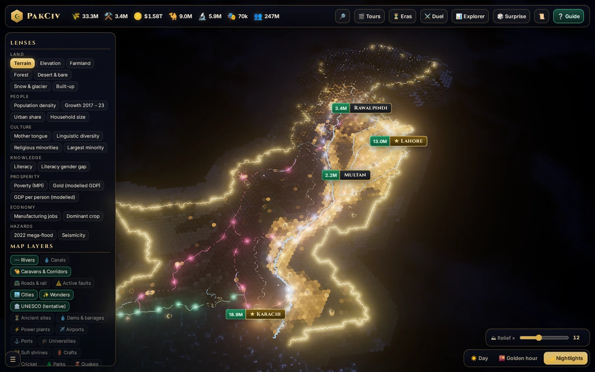

### 2022 mega-flood replay

The flood lens paints UNOSAT's satellite flood footprint onto the board. Press ▶ to play **10 satellite snapshots** from
August to December 2022: water caps rise and recede hex by hex while live counters show km² under water and people
exposed. NDMA (1,739 deaths) and the PDNA (US$14.9 bn damage) provide the headline facts. District headlines use the
cloud-free weekly peak, because the monthly VIIRS composite also catches flooded rice paddies. This is documented in the
Almanac.

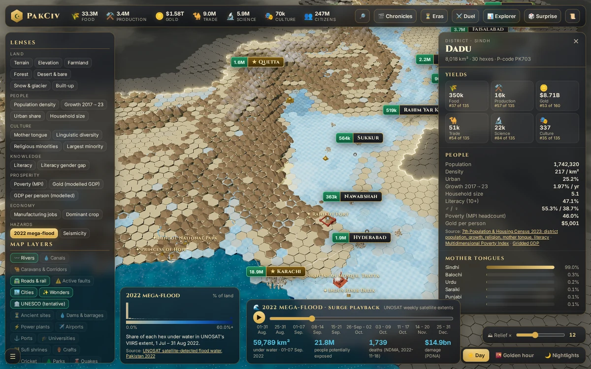

### Era Time-Machine

**9,000 years on the same hexes.** Drag through 8 eras:
1. Mehrgarh Neolithic
2. Indus Valley (Harappan)
3. Gandhara
4. Arab Sindh
5. Ghaznavids & Delhi Sultanate
6. Mughal Empire
7. Sikh Empire & British Raj (canal colonies)
8. Modern Pakistan

42 dated sites rise as beams of light, and the lighting and layers change with each era.

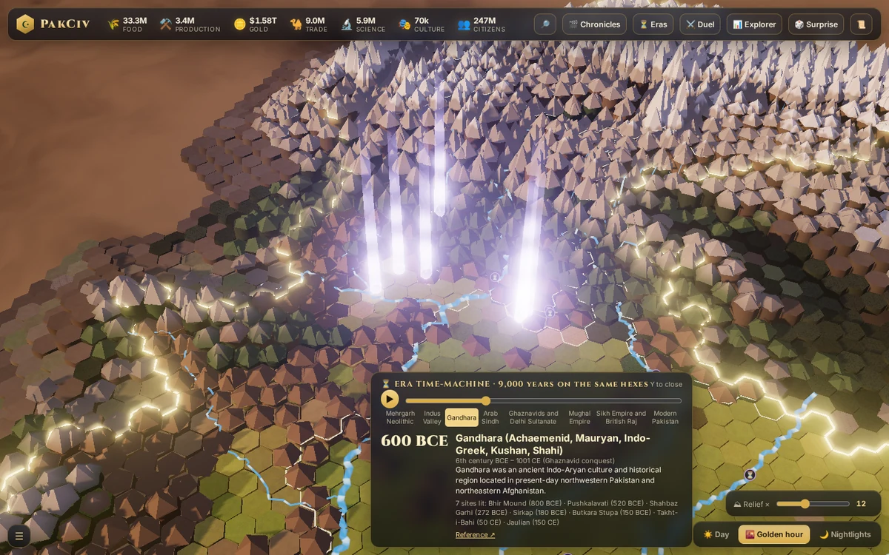

### Chronicles of Pakistan: guided tours

There are seven cinematic camera tours, and every caption number is computed live from the data:
- *From K2 to the Arabian Sea*
- *The Indus Food Machine*
- *Made in Pakistan: the Industrial Belt*
- *5,000 Years of Wonders*
- *The 2022 Deluge*
- *Tongues of the Indus*
- *Caravans & Corridors*

### District Duel

Pick any two districts by typing, clicking the map, or using a preset such as Lahore vs South Karachi, Faisalabad vs
Sialkot or Skardu vs Gwadar. The duel shows a percentile radar, head-to-head yields with crowns, and a verdict sentence
computed from the data.

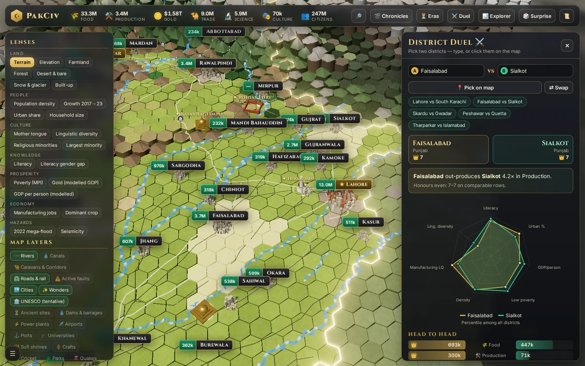

### Explorer

Explorer has a sortable table of all 160 districts next to a scatter plot. You can choose any two columns, switch either
axis to a log scale and see the Pearson r. Click a row or point to fly to that district, or drag on the plot to brush
districts and light them up on the 3D map.

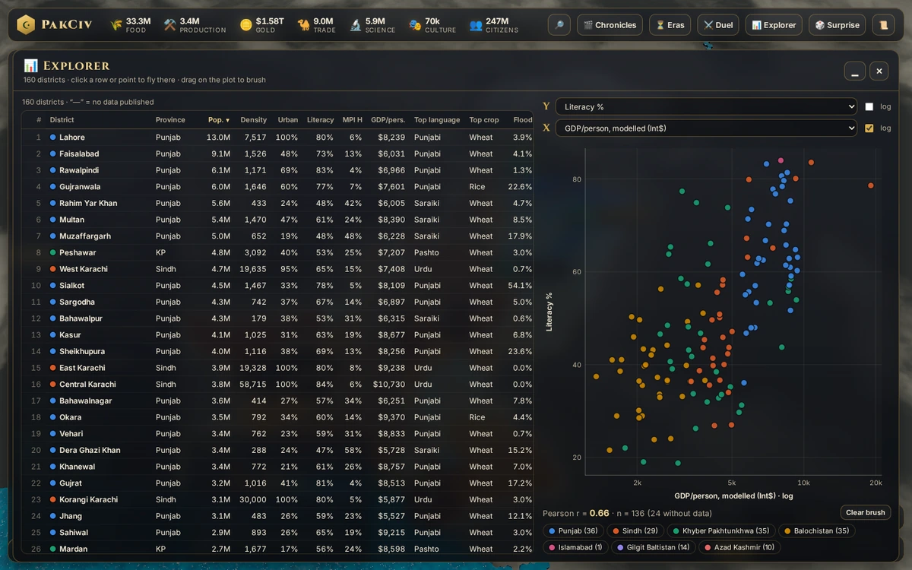

### Surprise me, Search & the Almanac

- **Surprise me** flies to one of 17 remarkable outliers computed live from the data, such as the highest hex, the
  densest hex, the hottest city or the biggest breadbasket.
- **Search** (`/`) is a fuzzy search over 160 districts and 418 places: cities, wonders, dams, peaks, plants and more.
- **The Almanac** (`A`) lists all 23 sources with publisher, vintage, licence, what each source is used for, honest
  caveats and file-level provenance (URL, bytes, sha256, retrieval date).
- **Shareable views:** the URL hash stores the lens, the lighting mood and the selected district or site.

| Surprise me | Almanac |
|:-:|:-:|
| 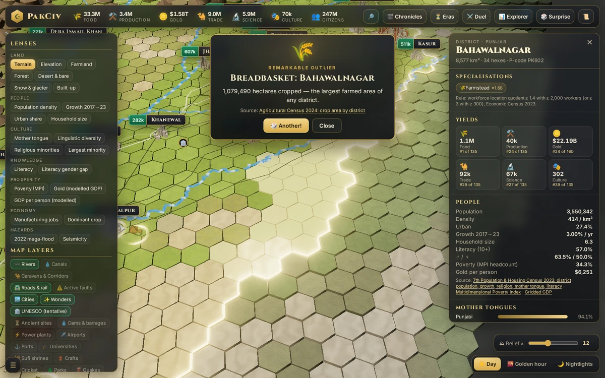 | 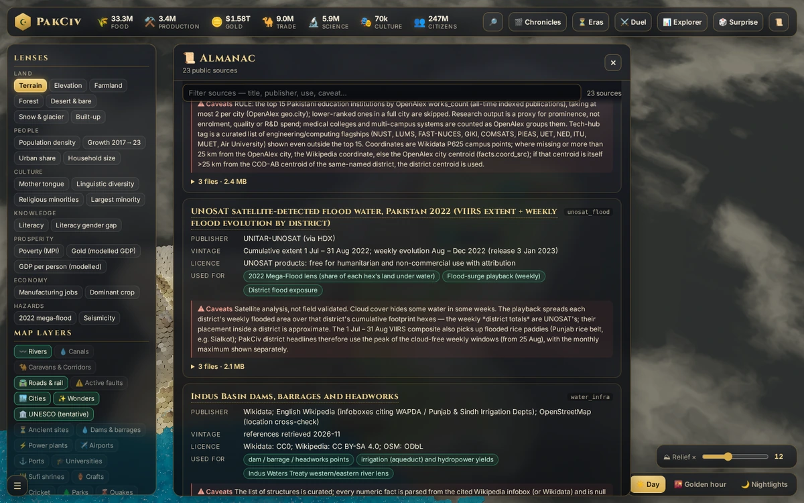 |

### Welcome & interactive walkthrough

First-time visitors see a plain-language welcome. It needs no Civ knowledge and shows every capability with live counts
read from the data. From there you can start a **19-step spotlight walkthrough** that demonstrates each feature on the
real UI. You can move through it with Back, Next, Skip, ← → and Esc. "Don't show this again" is saved in localStorage,
and the **❔ Guide** button (or `?`) reopens the welcome any time. Shared deep links skip the welcome.

| Welcome | Walkthrough step 11 / 19 |
|:-:|:-:|
|  | 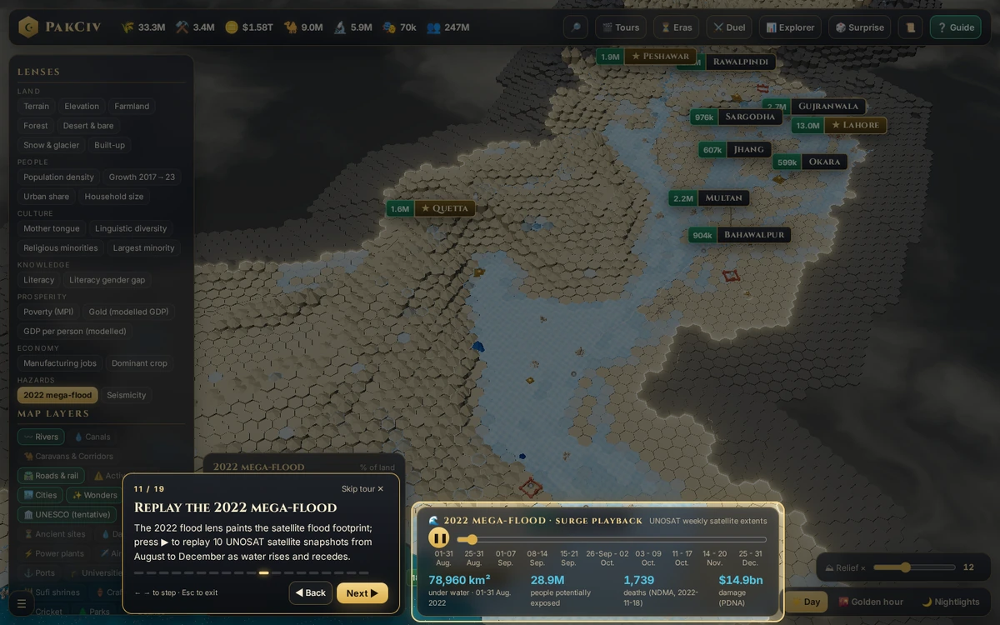 |

### Controls & keyboard shortcuts

| Input | Action |
|---|---|
| Drag / right-drag / scroll | Pan / orbit / zoom (zooms toward the cursor) |
| Click / Shift-click / double-click | Inspect hex or site / open whole district / fly to the selected hex |
| `/` | Search |
| `T` | Chronicles (guided tours) |
| `Y` | Era Time-Machine |
| `D` | District Duel |
| `E` | Explorer |
| `S` | Surprise me |
| `A` | Almanac |
| `L` | Cycle lighting: Day → Golden hour → Nightlights |
| `[` / `]` | Relief down / up (×1–×30) |
| `1`–`9` | Jump to the first nine lenses |
| `H` | Home view |
| `?` or `G` | Welcome guide & walkthrough |
| `Esc` | Close panels, stop the tour, clear the selection |

---

## Yields: the game words and what they really measure

The yield bar across the top uses Civ vocabulary, but each yield is a specific, cited measure:

| Yield | Real measure | Source | National total |
|---|---|---|---|
| 🌾 **Food** | Cropped area (hectares) | PBS Agricultural Census 2024 | 33.3 M ha |
| ⚒️ **Production** | Workforce in mining, manufacturing, utilities & construction (PSIC B–F) | PBS Economic Census 2023 | 3.4 M workers |
| 🪙 **Gold** | **Modelled** GDP, PPP, 2024 (not official district accounts) | Kummu et al. gridded GDP | Int$ 1.58 T |
| 🐪 **Trade** | Workforce in wholesale & retail, transport, hotels (PSIC G–I) | PBS Economic Census 2023 | 9.0 M workers |
| 🔬 **Science** | Workforce in ICT, finance, professional/scientific services & education (PSIC J, K, M, P) | PBS Economic Census 2023 | 5.9 M workers |
| 🎭 **Culture** | Workforce in arts, entertainment & recreation (PSIC R) | PBS Economic Census 2023 | 70 k workers |
| 👥 **Citizens** | Census 2023 population, plus WorldPop 2025 for AJK & GB | PBS Census 2023 · WorldPop | 247.4 M (241,499,431 censused) |

City districts (11 types, such as Industrial zone, Campus, Harbor & logistics, Mine, Farmstead and Powerhouse) are
assigned when a city's workforce location quotient in the matching PSIC sections passes a published threshold.

---

## Architecture

```
 public sources ──► pipeline/sources/*.py ──► data/interim/<id>.json ──► pipeline/build/*.py ──► web/public/data/*.json ──► Vite static site (Three.js)
 (23, cached with       one module per             (git-ignored)              world / atlas /             (the data contract)          no backend, no API keys
  sha256 provenance)    publisher + INFO dict                                 layers / catalog
```

**Frontend: a 100% static site.** It is built with Vite and uses no backend or API keys. You can deploy it to GitHub Pages,
Cloudflare Pages, S3 or any other static host.

- **Renderer:** Three.js on WebGL. A `WebGLRenderer` with ACES tone mapping and shadows feeds an `EffectComposer` with an
  `UnrealBloomPass` (this drives the glowing frontier, nightlights, corridors and era beams). The camera uses
  `MapControls` with zoom-to-cursor and eased fly-to.
- **Hex board** ([web/src/scene/board.js](web/src/scene/board.js)): every hex is an extruded prism in **one
  `InstancedMesh`**. Shader patches added with `onBeforeCompile` draw procedural terrain detail, lens colours,
  highlights and the night glow. A second `InstancedMesh` draws the peaks.
- **Environment** ([environment.js](web/src/scene/environment.js)): custom `ShaderMaterial`s for the animated sea, the sky
  and the cloud "void", plus the Day, Golden hour and Nightlights lighting rigs.
- **Lines** ([lines.js](web/src/scene/lines.js)): rivers, canals, roads, rail, faults and corridors, drawn as shader
  ribbons with flowing currents and travelling caravan pulses.
- **Sites** ([sites.js](web/src/scene/sites.js)): instanced city skylines, wonder silhouettes and icon pins. City
  banners and wonder labels are **`CSS2DObject`** labels, decluttered in screen space.
- **UI** ([web/src/ui/](web/src/ui)): one module per panel (inspector, lenses, search, almanac, explorer, duel, tours,
  eras, flood, surprise, guide), wired together by [web/src/app.js](web/src/app.js). The app is exposed as
  `window.__livingpakistan` for scripting and screenshots.

**Data contract.** The browser loads `manifest.json`, then the six files it lists from
[web/public/data/](web/public/data), about 1.9 MB of JSON in total:

| File | Size | Contents |
|---|---:|---|
| `world.json` | 648 KB | Hex grid and projection, owner district per hex, land/sea/lake, mean and max elevation, relief, terrain class, land-cover shares, 2022 flood % |
| `atlas.json` | 339 KB | 160 districts with all their statistics, 7 provinces, national totals, yield definitions, PSIC sections, city-district rules, 24 lens definitions, flood periods |
| `cells.json` | 373 KB | Per-hex population, density, modelled GDP and earthquake statistics |
| `layers.json` | 365 KB | Line layers (rivers, canals, roads, rail, corridors, faults), 418 sites, 8 eras, Indus Waters Treaty rivers |
| `sources.json` | 157 KB | The Almanac: 23 sources with licence, caveats and file provenance |
| `districts.json` | 17 KB | Compact district table (names, provinces, centroids) |
| `manifest.json` | 66 B | The list of files above |

**Pipeline** ([pipeline/](pipeline)): Python.
- [pipeline/common.py](pipeline/common.py) provides cached downloads with a provenance manifest (url, bytes, sha256,
  date), the Pakistan-tuned Albers projection and the pointy-top hex grid (10 km radius).
- Each module in `pipeline/sources/` handles one publisher. It writes `data/interim/<id>.json` and exposes an `INFO`
  dict that becomes that source's Almanac entry.
- `pipeline/build/` joins everything onto the 160-district OCHA COD-AB frame and the hex grid.
- Large rasters (Copernicus DEM, ESA WorldCover, Kummu GDP) are **never fully downloaded**. They are read in place as
  cloud-optimised GeoTIFFs over HTTP range requests (`/vsicurl/`).

---

## Data sources (all 23)

This table is generated from [web/public/data/sources.json](web/public/data/sources.json). The in-app Almanac has full
licences, caveats and file hashes for each source.

| # | Source | Publisher | Vintage | What it powers in living pakistan |
|---:|---|---|---|---|
| 1 | [Airports (OurAirports) with PCAA annual traffic](https://ourairports.com/data/) | OurAirports (public domain); Pakistan Civil Aviation Authority, Statistics Branch | OurAirports snapshot at retrieval; PCAA FY 2024-25 (July 2024 - June 2025) | airport points; airport icon size by annual passengers |
| 2 | [7th Population & Housing Census 2023: district population, growth, religion, mother tongue, literacy](https://www.pbs.gov.pk/census/) | Pakistan Bureau of Statistics | Census 2023 (reference date 1 Mar 2023) | Population / density / urbanisation lens; Population growth 2017-2023; Religion and mother-tongue composition; Literacy (10+) by sex; Age structure (under 15, 60+) |
| 3 | [Major cities: location, Census 2023 urban-locality population, district](https://www.pbs.gov.pk/digital-census/detailed-results) | Pakistan Bureau of Statistics (population); Wikidata contributors (coordinates); OCHA COD-AB (districts) | 7th Population and Housing Census 2023 (PBS); Wikidata P625 retrieved at build time | city markers and labels; city population ranking; capital symbols; city -> district join |
| 4 | [Pakistan subnational administrative boundaries (COD-AB)](https://data.humdata.org/dataset/cod-ab-pak) | OCHA / HDX | 2022 frame (valid 2022-09-09), HDX revision 2026-08-14 | District & province borders; The 160-district frame every table joins to |
| 5 | [Copernicus DEM GLO-90 (digital surface model)](https://registry.opendata.aws/copernicus-dem/) | European Space Agency / Copernicus, via AWS Open Data Registry | GLO-90 2021 release (TanDEM-X acquisitions 2011–2015) | Hex elevation (mean / max); Relief classes (flat, hills, mountains, peaks); 3D tile heights; Coast / sea mask |
| 6 | [Agricultural Census 2024: crop area by district (Table 5)](https://www.pbs.gov.pk/agriculture-census/) | Pakistan Bureau of Statistics (PBS) | Agricultural Census 2024 (district tables released 2025) | Food yield (crop area); dominant crop per district |
| 7 | [Cultural mosaic: Sufi shrines, craft hubs and cricket grounds](https://www.wikidata.org/) | Wikidata / Wikipedia (curated list) | Wikidata/Wikipedia as retrieved 2026-11 | Culture lens pins (shrine / craft / cricket); City View badges |
| 8 | [Economic Census 2023: establishments and workforce by PSIC section](https://www.pbs.gov.pk/pakistan-bureau-of-statistics-economic-statistics-production/) | Pakistan Bureau of Statistics (PBS) | Economic Census of Pakistan 2023 (results released 2024-25) | Jobs / workforce lens; industry-district specialisation (PSIC section shares); Food (farm workforce) |
| 9 | [Civilisation eras and era-defining sites of Pakistan](https://en.wikipedia.org/wiki/History_of_Pakistan) | Wikipedia (English) and Wikidata contributors | Wikipedia/Wikidata as retrieved 2026-11 | timeline scrubber eras; era site markers (Wonders/Almanac) |
| 10 | [ESA WorldCover 10 m 2021 v200](https://esa-worldcover.org/en) | European Space Agency (ESA WorldCover consortium), AWS Open Data | 2021 (v200) | Terrain type per hex; Farmland / Forest / Desert / Glacier / Built-up lenses |
| 11 | [Gridded GDP (PPP), MODELLED -- Kummu et al.](https://zenodo.org/records/18429133) | Kummu, Kosonen & Masoumzadeh Sayyar (Aalto University), Scientific Data 12:178 (2025); Zenodo v4 | 2024 band of the 1990-2024 dataset (Zenodo record 18429133, published 2026-03-13) | Gold yield (modelled GDP) for hexes and districts |
| 12 | [Natural hazards of Pakistan: earthquakes, faults, heat, glacial floods, 2022 floods, EM-DAT](https://earthquake.usgs.gov/earthquakes/search/) | USGS ComCat; GEM Foundation; CRED EM-DAT via HDX; NDMA Pakistan; World Bank/GoP PDNA; WMO; UNDP/GCF; Wikipedia/Wikidata | ComCat 1900-2026-11; EM-DAT profile 2026-11-25; NDMA SITREP 158 (18 Nov 2022); PDNA Oct 2022 | Hazards layer: earthquake dots and fault lines; Disaster Almanac (notable quakes, 2022 floods); Surprise Me: heat records (Jacobabad, Turbat, Mohenjo-daro); GLOF sites in GB/KP; EM-DAT summary charts |
| 13 | [Multidimensional Poverty Index (MPI) by district](https://ophi.org.uk/Publications/National-MPI/Pakistan-MPI-2019%E2%80%9320) | Ministry of Planning, Development & Special Initiatives (Planning Commission), with UNICEF/UNDP and OPHI | PSLM 2019-20 (MPI Report 2019-20, published 2024); fallback PSLM 2014-15 (report 2016) | Poverty lens (MPI, headcount H, intensity A); City View prosperity row |
| 14 | [Natural Earth 1:10m land, lakes and countries (v5.1)](https://www.naturalearthdata.com/) | Natural Earth | v5.1.x | Coastline / sea mask; Neighbouring countries (fog of war); Lakes |
| 15 | [Seaports and harbours](https://msi.nga.mil/Publications/WPI) | US NGA (World Port Index, Pub 150); Natural Earth; Finance Division, Govt of Pakistan (Pakistan Economic Survey 2024-25); Wikidata | WPI copy of 2024-05 (RIMES mirror); cargo FY 2023-24 (PES 2024-25) | port points; port icon size by cargo tonnage |
| 16 | [Power plants (WRI Global Power Plant Database + curated post-2018 supplement)](https://datasets.wri.org/dataset/globalpowerplantdatabase) | World Resources Institute et al. (GPPD v1.3.0); supplement: CPEC Authority, Wikidata, Wikipedia, OpenStreetMap | GPPD v1.3.0 (2021); supplement checked 2026-11 | power plant points sized by capacity and coloured by fuel; district generation capacity |
| 17 | [OpenStreetMap Pakistan extract: roads, railways, canals, barrages](https://download.geofabrik.de/asia/pakistan.html) | OpenStreetMap contributors (extract by Geofabrik GmbH) | Snapshot at retrieval | motorway and national-highway lines; mainline/branch railway lines; large named irrigation canals; major rivers; barrage / dam / headworks locations |
| 18 | [UNESCO World Heritage Sites and Tentative List: Pakistan](https://whc.unesco.org/en/statesparties/pk) | UNESCO World Heritage Centre | WHC list as retrieved 2026-11 | Wonders layer: World Heritage badges; Almanac heritage entries |
| 19 | [Universities and tech hubs (OpenAlex research output)](https://openalex.org/) | OpenAlex (OurResearch); coordinates from Wikidata | OpenAlex snapshot as retrieved 2026-11 | University wonders / Science yield badges; Tech-hub cluster pins |
| 20 | [UNOSAT satellite-detected flood water, Pakistan 2022 (VIIRS extent + weekly flood evolution by district)](https://data.humdata.org/dataset/satellite-detected-water-extents-between-01-and-29-august-2022-over-pakistan) | UNITAR-UNOSAT (via HDX) | Cumulative extent 1 Jul – 31 Aug 2022; weekly evolution Aug – Dec 2022 (release 3 Jan 2023) | 2022 Mega-Flood lens (share of each hex's land under water); Flood-surge playback (weekly); District flood exposure |
| 21 | [Indus Basin dams, barrages and headworks](https://www.wikidata.org/) | Wikidata; English Wikipedia (infoboxes citing WAPDA / Punjab & Sindh Irrigation Depts); OpenStreetMap (location cross-check) | references retrieved 2026-11 | dam / barrage / headworks points; irrigation (aqueduct) and hydropower yields; Indus Waters Treaty western/eastern river lens |
| 22 | [Natural & cultural wonders and national parks](https://www.protectedplanet.net/en/country/PAK) | Wikidata / Wikipedia (curated list); UNEP-WCMC & IUCN Protected Planet (WDPCA) | Wikidata/Wikipedia as retrieved 2026-11; WDPCA v5 (HDX unep_wdpca_pak) | Wonders layer (natural & cultural); Surprise-Me outliers; National parks list |
| 23 | [WorldPop Global2 population 2025, Pakistan, constrained 1 km (R2025A v1)](https://hub.worldpop.org/) | WorldPop, University of Southampton | 2025 (R2025A, alpha release) | Spreading each district's Census 2023 population across its hexes; AJK & GB population (no census tables) |

---

## Honest caveats

- **District frame:** OCHA COD-AB 2022 (160 districts). Districts split after 2022 are folded back into their parents.
  Boundaries follow UN/OCHA convention and do not imply endorsement of any claim.
- **AJK and Gilgit-Baltistan** are not covered by the PBS Census 2023 or Economic Census tables. Their population comes
  from WorldPop 2025, and most of their district statistics show "—".
- **Gold is a model** (Kummu et al. gridded GDP, PPP), not official accounts.
- **Economic Census** workforce counts only establishments. Farms and households are excluded, which is why Food uses
  cropped area instead.
- **Agricultural Census** crop areas are larger than the usual official crop estimates. Use them for crop mix, not
  totals.
- **Flood extents** are satellite analyses, not field-validated. Cloud cover hides water in some weeks, and the monthly
  VIIRS composite also picks up flooded rice paddies.
- **Corridors** are drawn from OSM highway geometry and show routes only. They are not freight volumes.
- **Curated lists** (wonders, culture pins, eras, water infrastructure, post-2018 power plants) follow published rules
  that are stated in each source's Almanac caveats. Their facts are parsed from cited references or left null.

---

## Run it locally

Requirements: Node 18+.

```bash
npm install
npm run dev        # dev server at http://127.0.0.1:5173
npm run build      # static bundle in dist/ (relative base, so it works from any sub-path)
npm run preview    # serve dist/ at http://127.0.0.1:4173
```

**Verify the production build.** With `npm run preview` running in another terminal:

```bash
npm run verify     # headless Chromium (Playwright + SwiftShader) checks the production build
```

The verify script exercises every lens, mood, layer, panel, era and tour, plus the full 19-step guide and real mouse
input. It fails on any console error, warning or failed request.

**Screenshots** of the running dev server:

```bash
npm run shots -- "http://127.0.0.1:5173/#lens=language" out.png 1440 900 6000
```

---

## Rebuild the data

The processed data is already committed in `web/public/data/`, so you only need this step to refresh or extend it.
Raw downloads go to `data/raw/` and intermediates to `data/interim/` (both git-ignored).

```bash
python3 -m venv .venv
.venv/bin/pip install rasterio shapely pyproj pdfplumber openpyxl numpy pyshp osmium

# 1) one module per source → data/interim/<id>.json (cod_ab first: it defines the district frame)
for m in cod_ab dem landcover census2023 econ_census mpi crops gdp_grid unosat_flood hazards power_plants \
         airports ports transport water_infra cities unesco wonders universities culture eras; do
  .venv/bin/python -m pipeline.sources.$m
done

# 2) builders → web/public/data/*.json
for b in world atlas layers districts_web catalog manifest; do
  .venv/bin/python -m pipeline.build.$b
done
```

---

## Repository layout

```
livingpakistan/
├── web/                      Vite app root
│   ├── index.html
│   ├── src/
│   │   ├── main.js           boot: load data, build stage/board/environment, start App
│   │   ├── app.js            controller: HUD, lenses, layers, picking, keyboard, URL hash
│   │   ├── data.js  hex.js
│   │   ├── scene/            stage · board · environment · lines · sites · borders
│   │   └── ui/               inspector · lenses · search · almanac · explorer · duel · tours
│   │                         eras · flood · surprise · guide · panelkit · dom
│   └── public/data/          world · atlas · cells · layers · sources · districts · manifest (.json)
├── pipeline/
│   ├── common.py             downloads + provenance, projection, hex grid
│   ├── sources/              21 source modules (cod_ab, dem, landcover, census2023, …)
│   └── build/                world · atlas · layers · districts_web · catalog · manifest
├── scripts/                  screenshots.mjs · verify-prod.mjs · video/
├── docs/
│   ├── livingpakistan-data-sources.md   pre-build data audit (usaciv → Pakistan)
│   └── images/                  README screenshots
├── previews/                 full-resolution progress screenshots (+ local, git-ignored livingpakistan-demo.mp4)
├── PROGRESS.md               milestone log
└── vite.config.js · package.json
```

---

## Credits & licence

- **Inspiration:** Andrej Karpathy's [usaciv](https://karpathy.ai/usaciv/).
- **Built with:** [Three.js](https://threejs.org/), [Vite](https://vitejs.dev/), Cinzel & Inter (Fontsource),
  Playwright, and the Python geospatial stack (rasterio, shapely, pyproj).
- **Code:** MIT.
- **Data:** © the respective publishers, under the licences listed above and in the in-app Almanac. This includes
  OpenStreetMap data © OpenStreetMap contributors (ODbL), Copernicus DEM © DLR e.V. 2010-2014 and © Airbus 2014-2018,
  and ESA WorldCover © ESA WorldCover project 2021. Some sources (UNOSAT, EM-DAT, WDPCA) are licensed for
  non-commercial use only.
